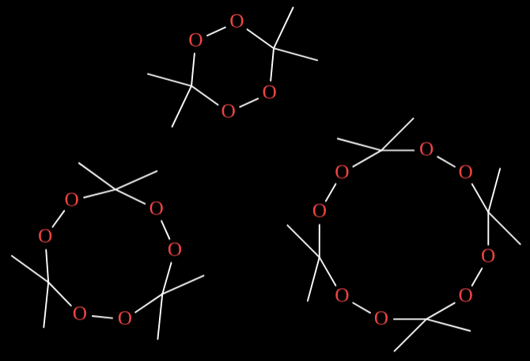
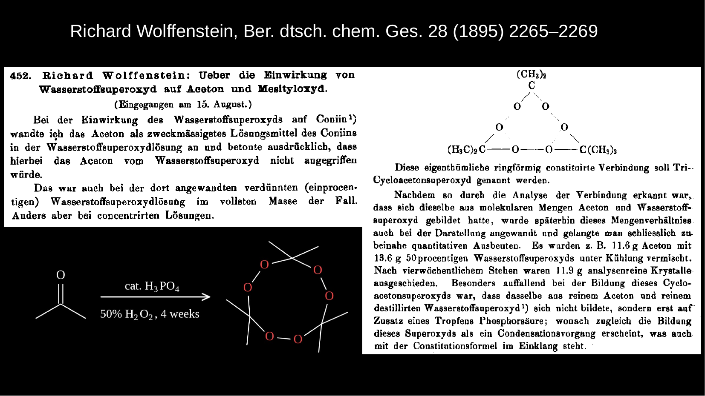
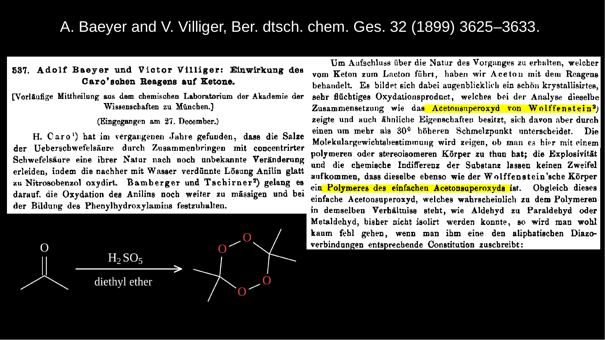
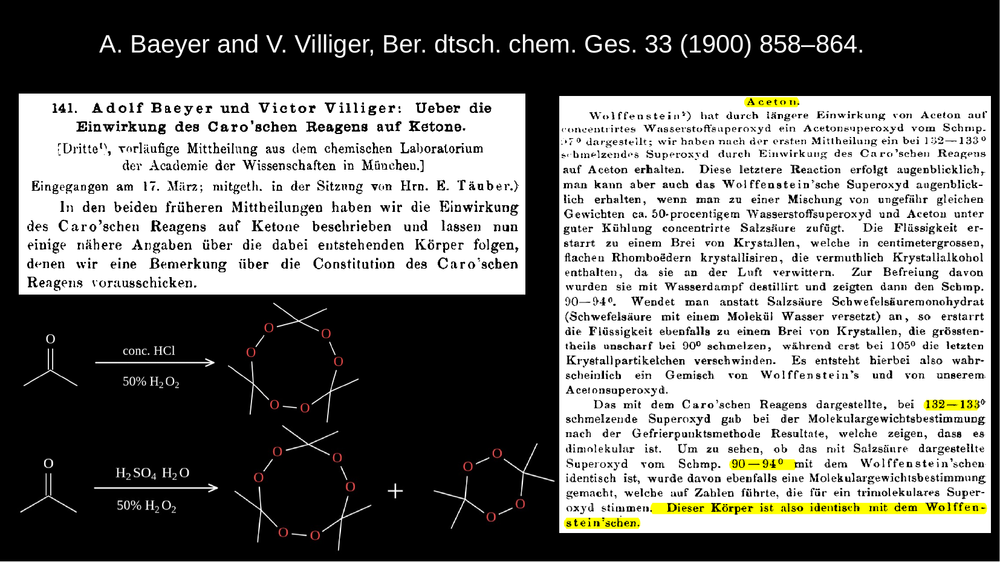
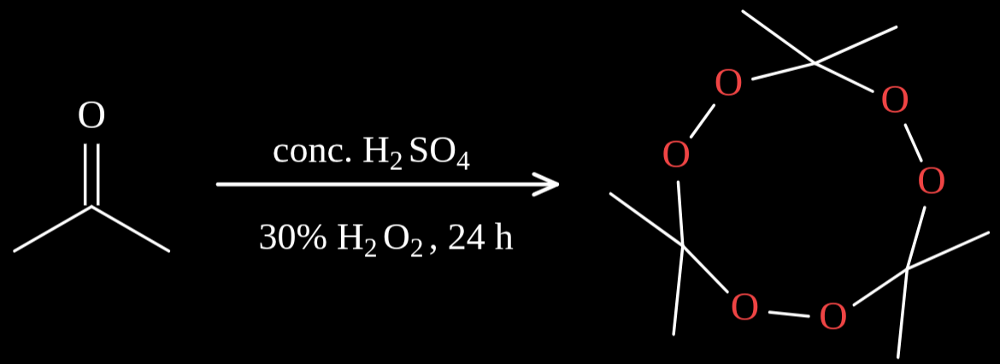
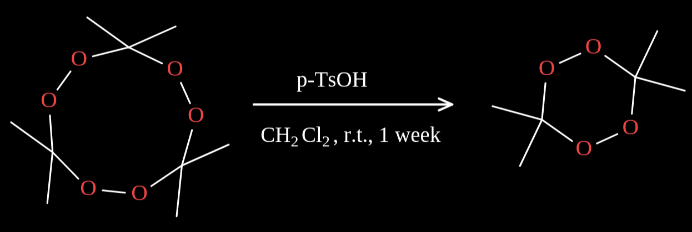
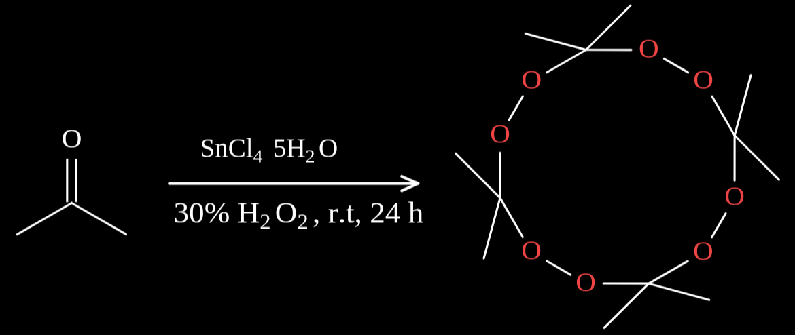
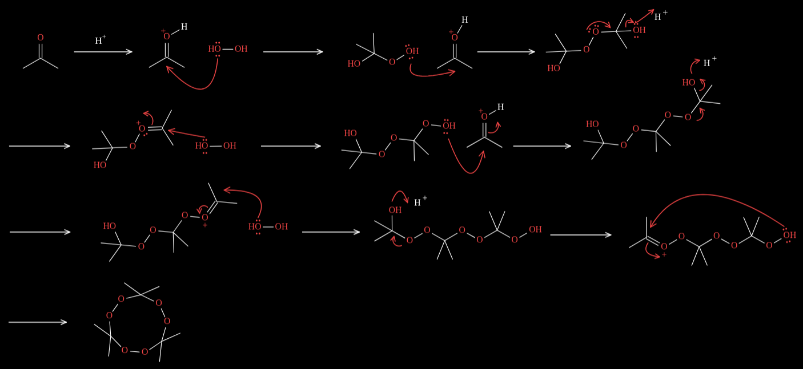
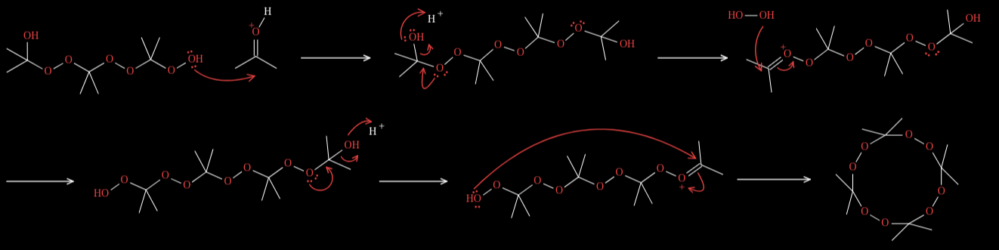
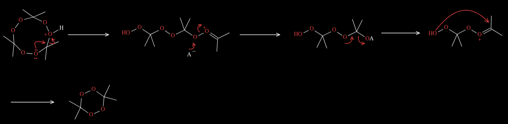

# APEX (acetone peroxide)
This repository documents the history and synthesis procedures of APEX, with the original sources provided as PDFs.
Some of the articles were originally written in German. English translations are also included.

Claude refused my prompt asking for APEX over and over again... :(

## Brief history

Aceton peroxide (APEX) is an organic peroxide classified as  a primary explosive.
It has been used in homemade explosives (HMEs) and in terrorist attacks, owing to its facile preparation
from readily available commercial precursors; acetone, hydrogen peroxide.
Among these APEX, triaceton triperoxide (TATP) is the one  most frequently employed in terrorist attacks.

In 1895, The German chemist Richard Wolfenstein serendipitously obtained acetone peroxide, now widely known as
triacetone triperoxide (TATP), while invetigating the action of hydrogen peroxide on coniine, the toxic alkalid
traditionally associated with the death of Socrates.
His synthesis involved treating acetone with hydrogen peroxide in the presence of a drop of phosphoric acid,
indicating an acid-catalyzed condensation process. He also demonstrated that TATP decomposed completely into aceton
and hydrogen peroxide upon warming with dilute sulfuric acid.[1][2]

In 1899, Baeyer and Villiger synthesized diacetone diperoxide (DADP) while investigating the action of  Caro's reagent(H2SO5) on acetone.They firstly assigned it as a polymer of acetone peroxide because its melting poiint (132-133) differed
from Wolfstein report's(m.p 97 degree).[3][4]
In 1900,  molecular weight dtermination showed that the compound was in fact a dimer of acetone peroxide (DADP).They also reported that TATP was formed in the presence of concentrated hydrochloric acid,whereas a mixture of dimer and trimer was obtained in the presence of sulfuric acid monohydrate. [5][6]

## Synthetic procedure

### TATP and DATP
Wolffenstein's synthesis has been employed for TATP. However, this method often affords a mixture of TATP and DADP.Therefore,many reserchers have attempted to modify it for optimaization.The yields of TATP and DADP depends on multiple factors, including the temperture,the type of acid such as HCl, H2SO4,H3PO4, and p-TsOH,
the concentration and molar ratio of acids and acetone, and the type of solvent (protic or aprotic).[7][8]
Although I searched for a reliable synthetic procedure, most of the reports I found were of questionable credibility and lacked yield data or sufficient experimental detail. 
Here, I provides a reliable method to obtain the pure DATP and TATP separately.[9]

**TATP:**

Acetone (5.6 g, 0.1 mol) was mixed with hydrogen
peroxide (30%, 0.1 mol), and the mixture was cooled to 0 °C.
Concentrated sulfuric acid (5 drops) was slowly added at the same
temperature, and the mixture was allowed to reach room temperature
and kept at this temperature without stirring for 24 h. The resultant
precipitate was collected by filtration with suction and air-dried to afford
TATP (4.7 g, 65%) in the form of white crystals.

**DADP:**

 Acetone (0.5 g, 8.6 mmol) was dissolved in either dry chloroform or dry dichloromethane, catalytic amounts of p-toluene-
sulfonic acid were added, and the mixture was kept at room temperature
for one week. The solvent was removed under reduced pressure, and
the residue was recrystallized from hot methanol to yield DADP (0.3 g, 2.0 mmol, 47%) in
the form of white powder. 

### TerATP
In contrast,a single procedure has been reported for the synthesis of terATP using a Lewis acid, SnCl4 5H2O, and.
to my knowledge, hardly any subsequent studies have followed this method. [10]
The only reports I found were a patent published in 2011 and a journal article.[11][12]
The patent did not provide reliable characterization data such as NMR, element analysis, or mass spectrometer,
offering only IR data. The article did not describe the synthesis procedure in detail and lacked a purification
procedure. I have doubts about its reproducibility. Moreover, according to the article [7], the choice of Lewis acid catalyst made no difference compared with the other acid catalysts, and TATP was always obtained as the main product rather than TertATP. This observation further supports my doubts about the reliability of this method.
For now, the original synthetic method and the patent method are described here.[10][11]

TertATP: 
From the article[10]: Acetone(8.12 g, 0.14 mol) was added to a solution of SnCl4 5H2O(350 mg, 1 mmol) in 20 ml 30% hydrogen peroxide and the mixture was vigorously stirred
with a magnetic stirrer at room temperture fr 24h. A white solid was produced gradually.
After the reaction was stopped, the unreacted acetone was evaporated on rotary evaporator at 25-30 C,
then the solid was filtered off, and washed with water. The solid thus obtained was recrystalized from a %50
acetone aqueous solution or benzene(4.67, 45%).

from the patent [11]: Cool acetone and hydrogen peroxide to -2C~5℃ and configure a saturated aqueous solution of SnCl4.
Add 24.36g of acetone (0.42mol) to a 500ml beaker, add 0.44mol of hydrogen peroxide dropwise and stir,
and control the temperature to 1℃. After adding the ingredients, stir for 10 minutes to make it completely mixed.
Place the beaker in the refrigerator for 2 hours, control the temperature to 0 ～5℃, remove the beaker, and slowly add
16 ml of saturated aqueous solution of SnCl4 using a constant pressure dropping funnel.
Stir slowly until a small amount of white precipitate appears in the beaker.
Place the beaker in the refrigerator, cover the cup with plastic wrap, let it stand and react for 96 hours,
and control the temperature to 2℃. There will be a large amount of sediment in the beaker after standing.
Add 50ml of 2℃ water to the beaker with sediment to make it suspend,
and filter. Wash 3 times with 1～2℃ water until neutral.
After natural shade drying, crude acetone peroxide product was obtained, with 23.41 g of white powdery crystals,
a yield of 79%, and a purity of 87%.
 Dissolve the obtained crude acetone peroxide tetramer with 180g of methanol and add it to 46℃ in a water bath.
After complete dissolution, add 36g of methanol, cool it naturally to crystallize, filter it, and
dry it naturally to obtain 20.7g of white powdery crystalline product with a purity of 94.1%.
 The yield is 70% at this time. After three purifications, the purity can reach 96.3%,
and the yield is 62%

## Reaction mechanism

## References
|Number| File name | Journal |
|------|-----------|---------|
|1|[wolffenstein1895.pdf](articles/wolffenstein_1895.pdf) |Ber. dtsch. chem. Ges. 28 (1895) 2265–2269. | 
|2|[wolffenstein1895_en.pdf](articles/wolffenstein1895_en.pdf)| English translation by Claude Opus 5.0 |
|3|[baeyer-villiger1899.pdf](articles/baeyer-villiger1899.pdf)|Ber. dtsch. chem. Ges. 32 (1899) 3625–3633.|
|4|[baeyer-villiger1899_en.pdf](articles/baeyer-villiger1899_en.pdf)| English translation by Claude Opus 5.0|
|5|[baeyer-villiger1900.pdf](articles/baeyer-villiger1900.pdf)|Ber. dtsch. chem. Ges. 33 (1900) 858–864.|
|6|[baeyer-villiger1900_en.pdf](articles/baeyer-villiger1900_en.pdf)|English translation by Claude Opus 5.0|
|7|[matyas2010.pdf](articles/matyas2010.pdf)|Propellants Explos. Pyrotech. 2010, 35, 31 – 37|
|8|[Bakuzis2026.pdf](articles/Bakuzis2026.pdf)|Tetrahedron 195 (2026) 135237|
|9|[dubnikova2005.pdf](articles/dubnikova2005.pdf)|J. AM. CHEM. SOC. 2005, 127, 1146-1159|
|10|[jiang1999.pdf](articles/jiang1999.pdf)|J. Chem. Research (S), 1999, 288-289|
|11|[CN102584782A.pdf](articles/CN102584782A.pdf)|patent CN102584782A (2012)|
|12|[pena2005.pdf](articles/pena2005.pdf)| Proc. of SPIE Vol. 5778|
